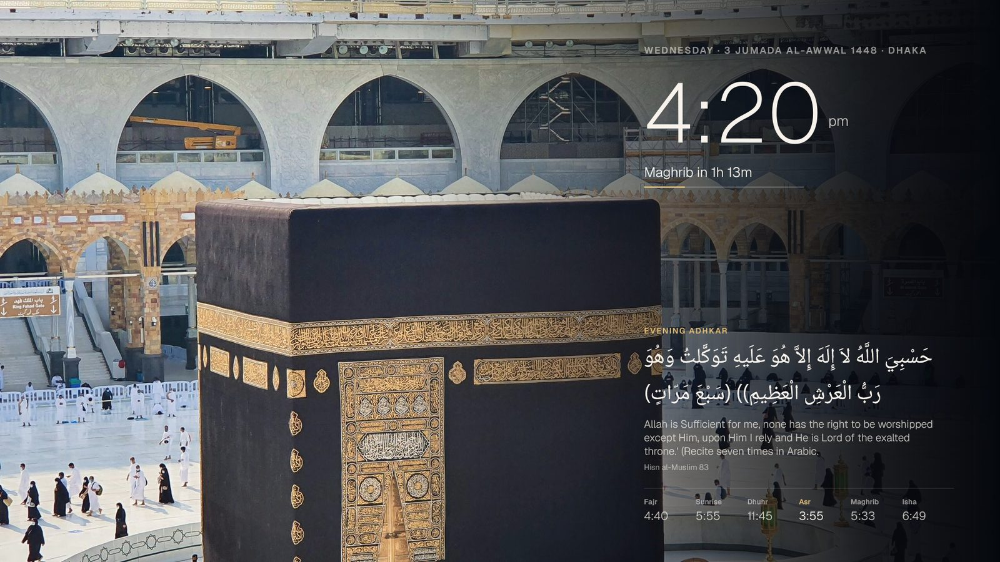
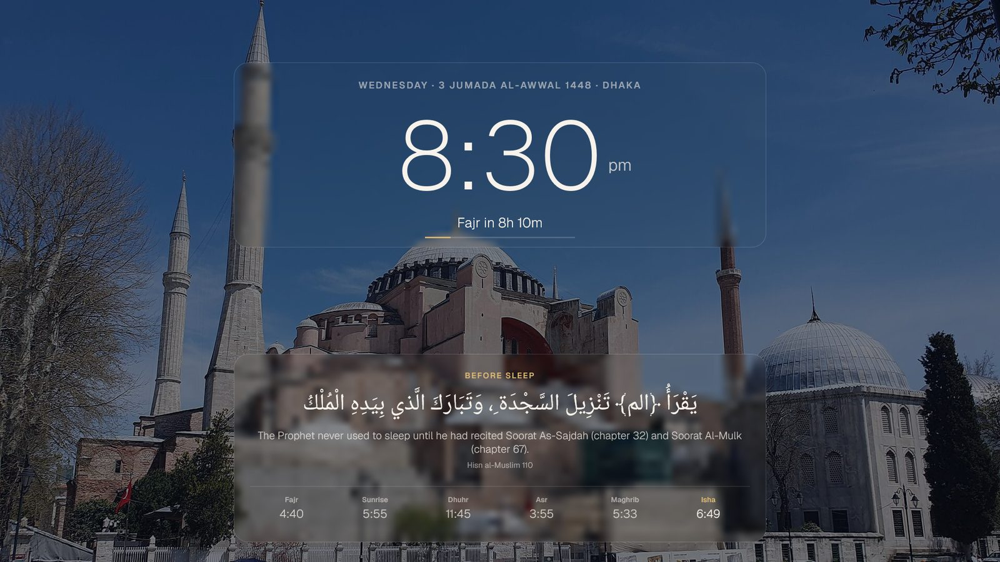
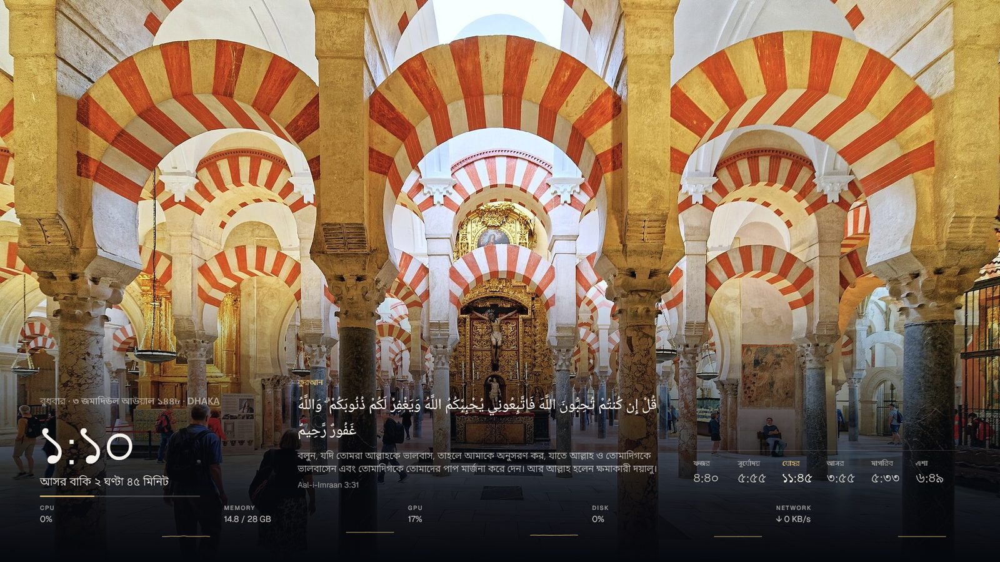
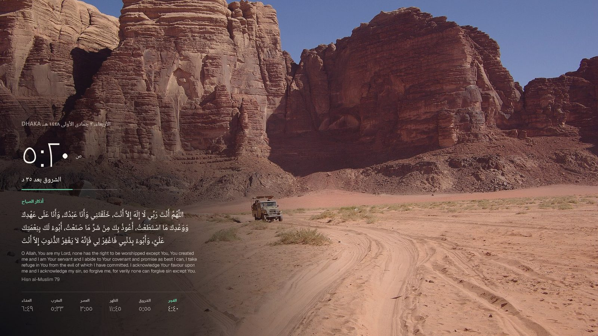
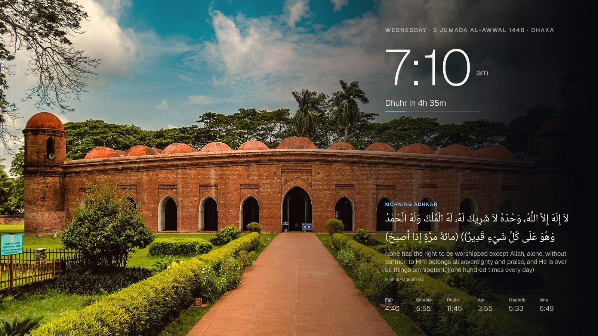
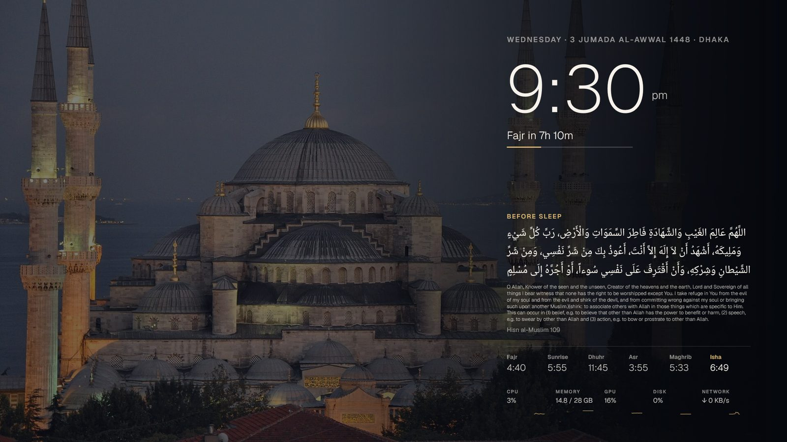

# Miqaat Wallpaper

A calm live wallpaper for Windows. Today's prayer times, the next prayer, and one authentic reminder at a time with its source, drawn behind your desktop icons on a photo of a great mosque or a quiet landscape. It's written in Rust and uses about 30 MB of memory.

**[Download for Windows](https://github.com/Saimon8420/miqaat-wallpaper/releases/latest/download/MiqaatWallpaper-Setup.exe)** · **[Live demo](https://saimon8420.github.io/miqaat-wallpaper/)** · [How to install](#install)



## Try it live

The **[live demo](https://saimon8420.github.io/miqaat-wallpaper/)** is an interactive preview of the wallpaper and its settings: pick a city, a calculation method, a picture, a layout or a time of day, with real prayer times from the Miqaat API. Its source is in [`docs/`](docs/) (built by `tools/site/build_site.py`).

## Screenshots

| | |
|---|---|
|  |  |
|  |  |

## What it does

- **Prayer times** for any city, from the [Miqaat API](https://miqaat-dev.vercel.app), with 12 calculation methods, Standard or Hanafi Asr, and a Hijri date you can adjust by ±2 days to match your country's moon sighting.
- **The next prayer** with a countdown and a progress line. You can turn on a small, quiet Windows notification at each prayer time.
- **One reminder at a time** (Quran, hadith, dua, dhikr, istighfar or durood), in Arabic with its meaning in English or Bangla and the exact reference.
- **Reminders follow the time of day:** morning adhkar after Fajr, adhkar after each salah, evening adhkar after Asr, the iftar dua in Ramadan, and duas before sleep.
- **Special days**, shown only where the evidence is clear: White Days, Mondays and Thursdays, Ashura, the Day of Arafah, the first ten days of Dhu al-Hijjah, the last ten nights of Ramadan, Eid, Shawwal and Fridays. Fasting days get a heads-up the evening before.
- **20 pictures** (Kaaba, Madinah, Al-Aqsa, Córdoba, Hagia Sophia, Shat Gumbad, Star Mosque and more), or your own photo. Keep one, or get a new one every day or at each prayer.
- **The light follows the sky.** The picture turns rose at Fajr, gold at sunrise and orange at Maghrib, and darkens at night. You choose how dark.
- **Design options:** four layouts (column, centre, corner and bottom bar), three clock styles, Arabic digits, seconds, five accent colours, a soft shade or a frosted glass card, a slow camera drift, film grain and picture effects.
- **27 fonts:** 11 Arabic, 4 Bangla and 12 English. The wallpaper can be in English, বাংলা or العربية.
- **An optional system monitor** shows CPU, memory, GPU, disk and network with small history lines.
- **Light on your PC.** It pauses during games and full-screen video and saves power on battery. It works on several monitors and starts with Windows.



## Install

1. **Download** [`MiqaatWallpaper-Setup.exe`](https://github.com/Saimon8420/miqaat-wallpaper/releases/latest/download/MiqaatWallpaper-Setup.exe) (about 30 MB) from the [latest release](https://github.com/Saimon8420/miqaat-wallpaper/releases/latest).
2. **Run it.** Windows may say *"Windows protected your PC"* because the app is new and not code-signed. Click **More info**, then **Run anyway**.
3. **Choose Yes** to install for your account only. No admin rights are needed. It copies itself to `%LOCALAPPDATA%\Programs\Miqaat Wallpaper`, adds a Start menu entry and starts with Windows. Choose **No** to just try it once without installing.
4. **Set your city.** The settings window opens on the first run. After that, right-click the moon icon near the clock in the taskbar and choose **Settings…**. Every change shows on the wallpaper straight away.

It works on Windows 10 and Windows 11, including 24H2 and later.

**Update:** download the new version and run it. Your settings are kept.

**Uninstall:** go to *Settings › Apps › Installed apps › Miqaat Wallpaper › Uninstall*, or use the **Uninstall…** button in the app's System settings. Your normal wallpaper comes back.

### Options for IT and scripts

```
MiqaatWallpaper-Setup.exe --silent          install without questions
MiqaatWallpaper.exe --portable              run from anywhere without installing
MiqaatWallpaper.exe --settings              open the settings window
MiqaatWallpaper.exe --uninstall --silent    remove without questions
```

## Where the words come from

No text was typed from memory. A build script pulls every word from published datasets. Only the references were chosen by hand (`tools/refs.py`).

| | Source | Count |
|---|---|---|
| Quran | [holy-quran](https://www.npmjs.com/package/holy-quran) (MIT): Hafs text, Sahih International English, Bangla | 165 short, complete verses |
| Hadith | [hadith-api](https://github.com/fawazahmed0/hadith-api) (public domain), with gradings | 138 from Bukhari, Muslim, Tirmidhi and all of an-Nawawi's Forty |
| Adhkar | *Hisn al-Muslim* via [hisnmuslim.com](https://www.hisnmuslim.com), with item numbers | 125 duas, dhikr, istighfar and durood, all with Bangla |

The library is a 650 KB file built into the app, so reminders never need the internet. Prayer times are fetched once a month and saved. If you're offline, the saved month keeps working.

Days whose special worship is disputed are deliberately left out.

## How it works

- **Rust + Win32**, with no web view and no runtime. One 30 MB exe holds the photos (up to 4K), fonts and content.
- **Behind the icons.** The wallpaper window is a child of Explorer's desktop `WorkerW`. On Windows 11 24H2 and later, that window sits inside `Progman` and the desktop has no GDI surface, so the wallpaper is a layered child window.
- **Drawn in software** with Direct2D and DirectWrite on the CPU. A GPU render target would load the graphics driver into the process (about 100 MB). Each photo is decoded once at the monitor's size.
- **Small repaints.** The text panel redraws once a minute and the whole picture only when the light changes. With those options on, only the clock redraws each second and only the system strip every 2 seconds. Nothing redraws while a full-screen game or video is running.
- **Privacy.** The only network requests are to the Miqaat API (prayer times, about once a month) and to Open-Meteo when you search for a city. There's no telemetry.

## Build from source

You need Rust (stable, MSVC) and the Windows SDK, for the resource compiler.

```
cargo build --release          # target/release/MiqaatWallpaper.exe
cargo test                     # calendar, Hijri, special days, light and reminder tests
```

To rebuild the content library or the fonts (needs Node.js and Python 3):

```
cd tools
npm install
python build_content.py --show   # writes assets/content.json and prints every item to check
python fetch_fonts.py            # downloads the font subsets into assets/fonts
python gen_assets.py             # regenerates src/assets.rs
```

To render a frame to a PNG without touching the desktop (this is how the screenshots were made):

```
MiqaatWallpaper.exe --snapshot out.png --at 20:30 --set scene=hagia --set rotate=keep --set layout=centre --set behind=glass
```

## Credits and licence

The code is under the [MIT licence](LICENSE). The photos are from Wikimedia Commons and stay under their own licences. The fonts are under the SIL Open Font Licence. Every author and source is listed in [CREDITS.md](CREDITS.md).
